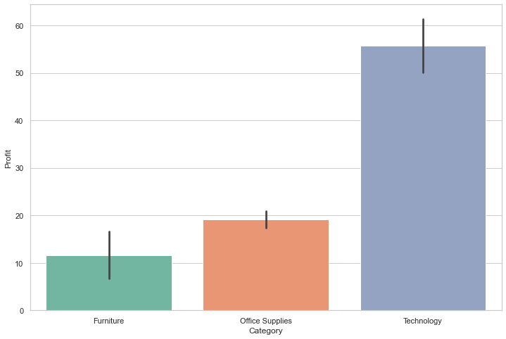
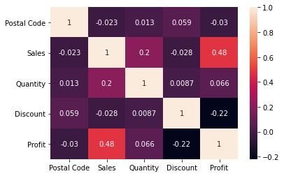
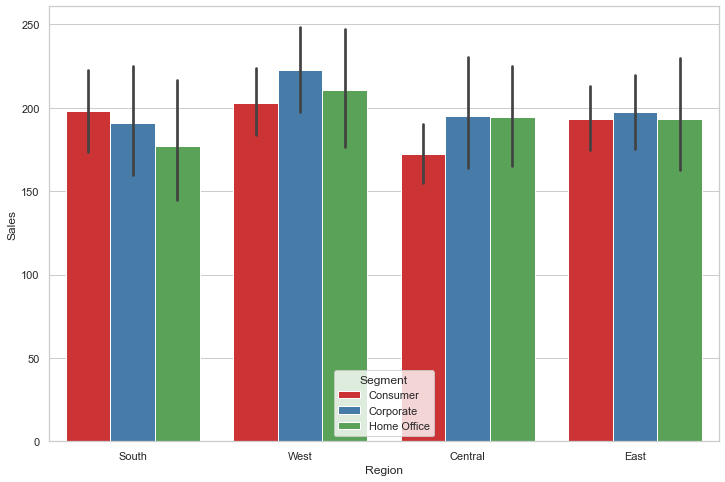
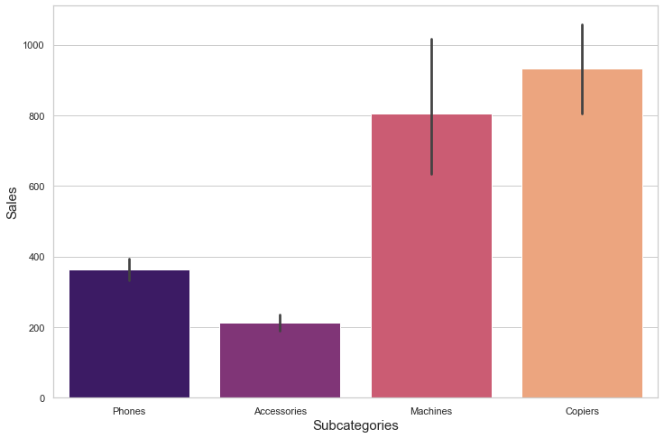

> Where does a retailer actually make its money? An analysis of about 10,000 superstore orders by category, region, and customer segment.

**Training project · Data Science & Business Analytics track**  
**Tools:** Python, pandas, NumPy, Matplotlib, Seaborn, Plotly

## The challenge

Sales alone can hide weak profit. The analysis looks at sales and profit together to find what to push and what to review.

## The data

The public Sample Superstore dataset: 9,977 orders after removing duplicates, with 13 fields covering shipping, customers, location, products, sales, discount, and profit.

## How it works

1. Removed 17 duplicate rows, leaving 9,977 orders.
2. Reviewed outliers before the deeper comparisons.
3. Compared shipping modes, customer segments, regions, states, and categories.
4. Measured how sales, quantity, discount, and profit move together.

## A closer look

- **Cleaning:** checked for duplicates and outliers before comparing groups.
- **Comparison:** sales and profit by shipping mode, segment, region, state, category, and sub-category.
- **Relationships:** a correlation matrix and pair plots across the main measures.

## Key decisions

- Sales and profit are read side by side, because high sales can come with weak profit.

## Results

| Measure | Result |
|---|---|
| Most profitable category on average | **Technology** |
| Largest customer segment | **Consumer** |
| Most used shipping mode | **Standard Class** |
| Sales vs profit correlation | **0.48** |
| Discount vs profit correlation | **−0.22** |

## Visual results

*Average profit by category: Technology leads clearly*

*Correlation between the main measures*

*Sales by region and customer segment*

*Sales by sub-category*

## Programming skills

- Python programming
- Data cleaning with pandas
- Grouping and aggregating data
- Correlation analysis
- Static and interactive charts
- Turning analysis into business insights

## Good to know

- Correlation shows that measures move together, not that one causes the other. The data is a public sample dataset.

## What I would do next

- Test discount levels directly, to find where profit turns negative.
- Add a time view to reveal seasons.

<strong>بالعربي: تحليل مبيعات وأرباح التجزئة</strong>

تحليل نحو 10,000 طلب لمعرفة مصدر الربح. التقنية هي الأعلى ربحًا في المتوسط، وكلما زاد الخصم قلّ الربح قليلًا (ارتباط −0.22).

**ملاحظة:** الارتباط لا يعني السببية، والبيانات عينة عامة.

**المهارات البرمجية:** Python programming، Data cleaning with pandas، Grouping and aggregating data، Correlation analysis، Static and interactive charts، Turning analysis into business insights.

الكود خاص، وهذه الصفحة تعرض فكرة المشروع وطريقة عمله ونتائجه.

---

**About the source code:** the code for this project is private. This page presents what it does, how it works, and its results. To talk about the work, contact me through my [GitHub profile](https://github.com/SamerAlTaki97).
